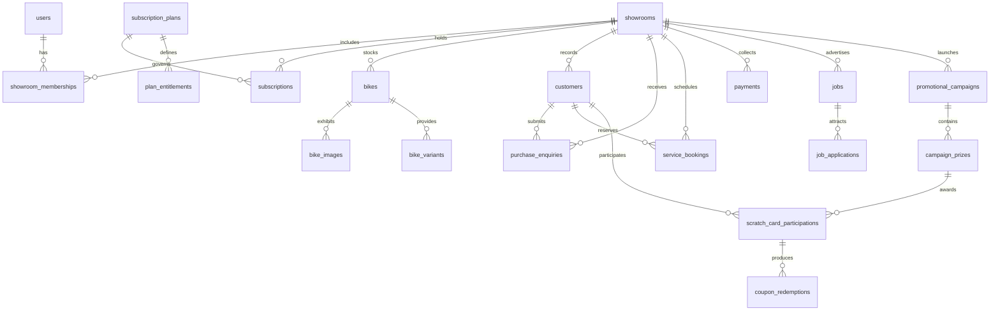

# MotoShowroom SaaS - Database Schema Design & ERD

## 1. Schema Conventions
* **Engine**: MySQL 8.0 InnoDB
* **Character Set & Collation**: `utf8mb4` / `utf8mb4_unicode_ci`
* **Primary Keys**: Big increments (`id BIGINT UNSIGNED AUTO_INCREMENT PRIMARY KEY`)
* **Tenant Reference**: `tenant_id BIGINT UNSIGNED` referencing `showrooms(id)` on delete cascade/restrict
* **Money & Monetary Columns**: `DECIMAL(12, 2)` (Strictly NO floating point types)
* **Date & Times**: Standard UTC `TIMESTAMP` with microsecond precision where applicable
* **Status Fields**: Enums / Varchar with check constraints or model cast Enums

---

## 2. Entity Relationship Overview (Mermaid)

---

## 3. Core Table Definitions

### 3.1 Authentication & Multi-Tenancy Core

#### `users`
* `id`: BIGINT UNSIGNED AUTO_INCREMENT PRIMARY KEY
* `name`: VARCHAR(255) NOT NULL
* `email`: VARCHAR(255) NOT NULL UNIQUE
* `password`: VARCHAR(255) NULL (nullable for OAuth accounts)
* `phone`: VARCHAR(30) NULL
* `avatar_url`: VARCHAR(1024) NULL
* `is_super_admin`: BOOLEAN DEFAULT FALSE
* `status`: VARCHAR(30) DEFAULT 'active' ('active', 'inactive', 'suspended')
* `email_verified_at`: TIMESTAMP NULL
* `remember_token`: VARCHAR(100) NULL
* `created_at`, `updated_at`: TIMESTAMP

#### `social_accounts`
* `id`: BIGINT UNSIGNED AUTO_INCREMENT PRIMARY KEY
* `user_id`: BIGINT UNSIGNED NOT NULL (FK -> users.id CASCADE)
* `provider`: VARCHAR(50) NOT NULL ('google', etc.)
* `provider_id`: VARCHAR(255) NOT NULL
* `token`: TEXT NULL
* `refresh_token`: TEXT NULL
* `expires_at`: TIMESTAMP NULL
* `created_at`, `updated_at`: TIMESTAMP
* *INDEX*: `UNIQUE(provider, provider_id)`

#### `showrooms` (Tenants)
* `id`: BIGINT UNSIGNED AUTO_INCREMENT PRIMARY KEY
* `name`: VARCHAR(255) NOT NULL
* `slug`: VARCHAR(255) NOT NULL UNIQUE
* `custom_domain`: VARCHAR(255) NULL UNIQUE
* `domain_verified_at`: TIMESTAMP NULL
* `email`: VARCHAR(255) NOT NULL
* `phone`: VARCHAR(50) NOT NULL
* `address_line1`: VARCHAR(255) NULL
* `address_line2`: VARCHAR(255) NULL
* `city`: VARCHAR(100) NULL
* `state`: VARCHAR(100) NULL
* `postal_code`: VARCHAR(20) NULL
* `country`: VARCHAR(100) DEFAULT 'India'
* `logo_url`: VARCHAR(1024) NULL
* `banner_url`: VARCHAR(1024) NULL
* `brand_color_primary`: VARCHAR(20) DEFAULT '#DC2626'
* `brand_color_accent`: VARCHAR(20) DEFAULT '#0F172A'
* `status`: VARCHAR(30) DEFAULT 'active' ('active', 'trial', 'past_due', 'suspended', 'cancelled')
* `public_website_enabled`: BOOLEAN DEFAULT TRUE
* `read_only_mode`: BOOLEAN DEFAULT FALSE
* `settings`: JSON NULL
* `created_at`, `updated_at`, `deleted_at`: TIMESTAMP

#### `showroom_memberships`
* `id`: BIGINT UNSIGNED AUTO_INCREMENT PRIMARY KEY
* `showroom_id`: BIGINT UNSIGNED NOT NULL (FK -> showrooms.id CASCADE)
* `user_id`: BIGINT UNSIGNED NOT NULL (FK -> users.id CASCADE)
* `role`: VARCHAR(50) NOT NULL ('owner', 'sales_manager', 'service_manager', 'service_advisor', 'hr_manager', 'marketing_manager', 'receptionist')
* `permissions`: JSON NULL (overriding specific permissions)
* `status`: VARCHAR(30) DEFAULT 'active' ('active', 'invited', 'suspended')
* `created_at`, `updated_at`: TIMESTAMP
* *INDEX*: `UNIQUE(showroom_id, user_id)`

---

### 3.2 Subscriptions & Entitlements

#### `subscription_plans`
* `id`: BIGINT UNSIGNED AUTO_INCREMENT PRIMARY KEY
* `name`: VARCHAR(150) NOT NULL
* `slug`: VARCHAR(150) NOT NULL UNIQUE
* `description`: TEXT NULL
* `monthly_price`: DECIMAL(12, 2) NOT NULL DEFAULT 0.00
* `annual_price`: DECIMAL(12, 2) NOT NULL DEFAULT 0.00
* `currency`: VARCHAR(3) NOT NULL DEFAULT 'INR'
* `trial_days`: INT UNSIGNED DEFAULT 14
* `max_staff_accounts`: INT UNSIGNED DEFAULT 5
* `max_bike_listings`: INT UNSIGNED DEFAULT 25
* `max_monthly_bookings`: INT UNSIGNED DEFAULT 100
* `media_storage_mb`: INT UNSIGNED DEFAULT 1024
* `has_careers_module`: BOOLEAN DEFAULT TRUE
* `has_scratch_cards`: BOOLEAN DEFAULT TRUE
* `has_360_viewer`: BOOLEAN DEFAULT TRUE
* `has_ai_assistant`: BOOLEAN DEFAULT FALSE
* `has_custom_domain`: BOOLEAN DEFAULT FALSE
* `has_advanced_analytics`: BOOLEAN DEFAULT FALSE
* `features_json`: JSON NULL
* `is_active`: BOOLEAN DEFAULT TRUE
* `sort_order`: INT DEFAULT 0
* `created_at`, `updated_at`: TIMESTAMP

#### `subscriptions`
* `id`: BIGINT UNSIGNED AUTO_INCREMENT PRIMARY KEY
* `showroom_id`: BIGINT UNSIGNED NOT NULL (FK -> showrooms.id RESTRICT)
* `plan_id`: BIGINT UNSIGNED NOT NULL (FK -> subscription_plans.id RESTRICT)
* `status`: VARCHAR(30) NOT NULL DEFAULT 'trial' ('trial', 'pending_payment', 'active', 'past_due', 'expired', 'suspended', 'cancelled')
* `billing_interval`: VARCHAR(20) NOT NULL DEFAULT 'monthly' ('monthly', 'annual')
* `current_period_start`: TIMESTAMP NOT NULL
* `current_period_end`: TIMESTAMP NOT NULL
* `trial_ends_at`: TIMESTAMP NULL
* `cancelled_at`: TIMESTAMP NULL
* `cancellation_reason`: TEXT NULL
* `suspension_reason`: TEXT NULL
* `auto_renew`: BOOLEAN DEFAULT TRUE
* `last_payment_reference`: VARCHAR(255) NULL
* `created_at`, `updated_at`: TIMESTAMP
* *INDEX*: `INDEX(showroom_id, status, current_period_end)`

#### `subscription_histories` (Audit of all changes)
* `id`: BIGINT UNSIGNED AUTO_INCREMENT PRIMARY KEY
* `subscription_id`: BIGINT UNSIGNED NOT NULL (FK -> subscriptions.id CASCADE)
* `showroom_id`: BIGINT UNSIGNED NOT NULL (FK -> showrooms.id CASCADE)
* `admin_user_id`: BIGINT UNSIGNED NULL (FK -> users.id SET NULL)
* `action`: VARCHAR(50) NOT NULL ('created', 'renewed', 'plan_changed', 'expiry_extended', 'status_changed', 'cancelled')
* `previous_status`: VARCHAR(30) NULL
* `new_status`: VARCHAR(30) NULL
* `previous_expiry`: TIMESTAMP NULL
* `new_expiry`: TIMESTAMP NULL
* `reason`: TEXT NULL
* `metadata`: JSON NULL
* `created_at`: TIMESTAMP

---

### 3.3 Payments & Transactions (Razorpay Integration)

#### `payments`
* `id`: BIGINT UNSIGNED AUTO_INCREMENT PRIMARY KEY
* `showroom_id`: BIGINT UNSIGNED NOT NULL (FK -> showrooms.id RESTRICT)
* `customer_id`: BIGINT UNSIGNED NULL (FK -> customers.id SET NULL)
* `payable_type`: VARCHAR(255) NOT NULL (e.g. `App\Models\Subscription`, `App\Models\ServiceBooking`)
* `payable_id`: BIGINT UNSIGNED NOT NULL
* `purpose`: VARCHAR(50) NOT NULL ('subscription_purchase', 'subscription_renewal', 'service_deposit', 'bike_booking_deposit')
* `amount`: DECIMAL(12, 2) NOT NULL
* `currency`: VARCHAR(3) NOT NULL DEFAULT 'INR'
* `razorpay_order_id`: VARCHAR(100) NULL UNIQUE
* `razorpay_payment_id`: VARCHAR(100) NULL UNIQUE
* `razorpay_signature`: VARCHAR(255) NULL
* `status`: VARCHAR(30) NOT NULL DEFAULT 'pending' ('pending', 'authorized', 'captured', 'failed', 'refunded', 'partially_refunded')
* `signature_verified`: BOOLEAN DEFAULT FALSE
* `error_code`: VARCHAR(100) NULL
* `error_description`: TEXT NULL
* `notes`: JSON NULL
* `created_at`, `updated_at`: TIMESTAMP
* *INDEX*: `INDEX(showroom_id, status, created_at)`

#### `refunds`
* `id`: BIGINT UNSIGNED AUTO_INCREMENT PRIMARY KEY
* `payment_id`: BIGINT UNSIGNED NOT NULL (FK -> payments.id RESTRICT)
* `showroom_id`: BIGINT UNSIGNED NOT NULL (FK -> showrooms.id RESTRICT)
* `razorpay_refund_id`: VARCHAR(100) NULL UNIQUE
* `amount`: DECIMAL(12, 2) NOT NULL
* `currency`: VARCHAR(3) NOT NULL DEFAULT 'INR'
* `reason`: TEXT NULL
* `status`: VARCHAR(30) NOT NULL DEFAULT 'pending' ('pending', 'processed', 'failed')
* `metadata`: JSON NULL
* `created_at`, `updated_at`: TIMESTAMP

#### `webhook_events` (Idempotent Webhook Processing Ledger)
* `id`: BIGINT UNSIGNED AUTO_INCREMENT PRIMARY KEY
* `event_id`: VARCHAR(100) NOT NULL UNIQUE (Razorpay Event ID)
* `event_type`: VARCHAR(100) NOT NULL
* `payload`: JSON NOT NULL
* `processed`: BOOLEAN DEFAULT FALSE
* `processed_at`: TIMESTAMP NULL
* `error_message`: TEXT NULL
* `created_at`, `updated_at`: TIMESTAMP

---

### 3.4 Customers & Motorcycle Inventory

#### `customers`
* `id`: BIGINT UNSIGNED AUTO_INCREMENT PRIMARY KEY
* `tenant_id`: BIGINT UNSIGNED NOT NULL (FK -> showrooms.id CASCADE)
* `user_id`: BIGINT UNSIGNED NULL (FK -> users.id SET NULL)
* `name`: VARCHAR(255) NOT NULL
* `email`: VARCHAR(255) NOT NULL
* `phone`: VARCHAR(30) NOT NULL
* `city`: VARCHAR(100) NULL
* `notes`: TEXT NULL
* `created_at`, `updated_at`: TIMESTAMP
* *INDEX*: `INDEX(tenant_id, email)`, `INDEX(tenant_id, phone)`

#### `bikes`
* `id`: BIGINT UNSIGNED AUTO_INCREMENT PRIMARY KEY
* `tenant_id`: BIGINT UNSIGNED NOT NULL (FK -> showrooms.id CASCADE)
* `manufacturer`: VARCHAR(100) NOT NULL
* `model`: VARCHAR(150) NOT NULL
* `variant`: VARCHAR(100) NULL
* `model_year`: SMALLINT UNSIGNED NOT NULL
* `category`: VARCHAR(50) NOT NULL ('Sports', 'Cruiser', 'Adventure', 'Commuter', 'Scooter', 'Electric')
* `engine_capacity_cc`: INT UNSIGNED NULL
* `fuel_type`: VARCHAR(30) DEFAULT 'Petrol' ('Petrol', 'Electric', 'Hybrid')
* `transmission`: VARCHAR(30) DEFAULT 'Manual' ('Manual', 'Automatic')
* `ex_showroom_price`: DECIMAL(12, 2) NOT NULL
* `on_road_price`: DECIMAL(12, 2) NULL
* `stock_quantity`: INT UNSIGNED DEFAULT 0
* `condition`: VARCHAR(20) DEFAULT 'new' ('new', 'used')
* `warranty_info`: VARCHAR(255) NULL
* `is_published`: BOOLEAN DEFAULT FALSE
* `is_featured`: BOOLEAN DEFAULT FALSE
* `has_360_view`: BOOLEAN DEFAULT FALSE
* `viewer_type`: VARCHAR(30) NULL ('image_sequence', 'gltf_model')
* `model_3d_path`: VARCHAR(1024) NULL
* `description`: LONGTEXT NULL
* `technical_specs`: JSON NULL
* `color_options`: JSON NULL
* `created_at`, `updated_at`: TIMESTAMP
* *INDEX*: `INDEX(tenant_id, is_published, category)`

#### `bike_images`
* `id`: BIGINT UNSIGNED AUTO_INCREMENT PRIMARY KEY
* `bike_id`: BIGINT UNSIGNED NOT NULL (FK -> bikes.id CASCADE)
* `tenant_id`: BIGINT UNSIGNED NOT NULL (FK -> showrooms.id CASCADE)
* `image_path`: VARCHAR(1024) NOT NULL
* `is_primary`: BOOLEAN DEFAULT FALSE
* `is_360_frame`: BOOLEAN DEFAULT FALSE
* `frame_angle`: INT NULL (0 to 359)
* `sort_order`: INT DEFAULT 0
* `created_at`, `updated_at`: TIMESTAMP
* *INDEX*: `INDEX(bike_id, is_360_frame, frame_angle)`

---

### 3.5 Enquiries, Test Rides, and Services

#### `purchase_enquiries`
* `id`: BIGINT UNSIGNED AUTO_INCREMENT PRIMARY KEY
* `tenant_id`: BIGINT UNSIGNED NOT NULL (FK -> showrooms.id CASCADE)
* `bike_id`: BIGINT UNSIGNED NULL (FK -> bikes.id SET NULL)
* `customer_id`: BIGINT UNSIGNED NOT NULL (FK -> customers.id RESTRICT)
* `type`: VARCHAR(30) DEFAULT 'purchase_enquiry' ('purchase_enquiry', 'test_ride_request', 'reservation')
* `preferred_test_ride_date`: DATE NULL
* `preferred_time_slot`: VARCHAR(30) NULL
* `status`: VARCHAR(30) DEFAULT 'new' ('new', 'contacted', 'test_ride_scheduled', 'negotiation', 'booking_pending', 'booked', 'completed', 'cancelled', 'lost')
* `customer_notes`: TEXT NULL
* `internal_notes`: TEXT NULL (Strictly staff-only, never sent to customer)
* `assigned_staff_id`: BIGINT UNSIGNED NULL (FK -> users.id SET NULL)
* `created_at`, `updated_at`: TIMESTAMP
* *INDEX*: `INDEX(tenant_id, status, created_at)`

#### `service_types`
* `id`: BIGINT UNSIGNED AUTO_INCREMENT PRIMARY KEY
* `tenant_id`: BIGINT UNSIGNED NOT NULL (FK -> showrooms.id CASCADE)
* `name`: VARCHAR(150) NOT NULL
* `description`: TEXT NULL
* `estimated_duration_minutes`: INT UNSIGNED DEFAULT 60
* `base_price`: DECIMAL(12, 2) NOT NULL DEFAULT 0.00
* `deposit_required`: DECIMAL(12, 2) NOT NULL DEFAULT 0.00
* `is_active`: BOOLEAN DEFAULT TRUE
* `created_at`, `updated_at`: TIMESTAMP

#### `service_bookings`
* `id`: BIGINT UNSIGNED AUTO_INCREMENT PRIMARY KEY
* `tenant_id`: BIGINT UNSIGNED NOT NULL (FK -> showrooms.id CASCADE)
* `customer_id`: BIGINT UNSIGNED NOT NULL (FK -> customers.id RESTRICT)
* `service_type_id`: BIGINT UNSIGNED NOT NULL (FK -> service_types.id RESTRICT)
* `bike_model`: VARCHAR(150) NOT NULL
* `registration_number`: VARCHAR(50) NULL
* `odometer_reading`: INT UNSIGNED NULL
* `booking_date`: DATE NOT NULL
* `time_slot`: VARCHAR(30) NOT NULL
* `status`: VARCHAR(30) DEFAULT 'pending' ('pending', 'confirmed', 'checked_in', 'in_service', 'ready_for_collection', 'completed', 'cancelled', 'no_show')
* `payment_status`: VARCHAR(30) DEFAULT 'unpaid' ('unpaid', 'deposit_paid', 'paid_in_full', 'refunded')
* `deposit_amount`: DECIMAL(12, 2) DEFAULT 0.00
* `total_amount`: DECIMAL(12, 2) DEFAULT 0.00
* `customer_notes`: TEXT NULL
* `internal_notes`: TEXT NULL
* `created_at`, `updated_at`: TIMESTAMP
* *INDEX*: `INDEX(tenant_id, booking_date, time_slot)`

---

### 3.6 Promotional Scratch Cards

#### `promotional_campaigns`
* `id`: BIGINT UNSIGNED AUTO_INCREMENT PRIMARY KEY
* `tenant_id`: BIGINT UNSIGNED NOT NULL (FK -> showrooms.id CASCADE)
* `name`: VARCHAR(150) NOT NULL
* `description`: TEXT NULL
* `start_date`: DATE NOT NULL
* `end_date`: DATE NOT NULL
* `status`: VARCHAR(30) DEFAULT 'draft' ('draft', 'active', 'paused', 'expired', 'archived')
* `min_booking_amount`: DECIMAL(12, 2) DEFAULT 0.00
* `max_participations_per_customer`: INT UNSIGNED DEFAULT 1
* `created_at`, `updated_at`: TIMESTAMP
* *INDEX*: `INDEX(tenant_id, status, start_date, end_date)`

#### `campaign_prizes`
* `id`: BIGINT UNSIGNED AUTO_INCREMENT PRIMARY KEY
* `campaign_id`: BIGINT UNSIGNED NOT NULL (FK -> promotional_campaigns.id CASCADE)
* `tenant_id`: BIGINT UNSIGNED NOT NULL (FK -> showrooms.id CASCADE)
* `title`: VARCHAR(150) NOT NULL
* `prize_type`: VARCHAR(50) NOT NULL ('free_accessory', 'service_discount', 'percentage_discount', 'fixed_coupon', 'better_luck')
* `discount_amount`: DECIMAL(12, 2) DEFAULT 0.00
* `discount_percentage`: DECIMAL(5, 2) DEFAULT 0.00
* `total_quantity`: INT UNSIGNED NOT NULL DEFAULT 0
* `remaining_quantity`: INT UNSIGNED NOT NULL DEFAULT 0
* `probability_weight`: INT UNSIGNED NOT NULL DEFAULT 10
* `created_at`, `updated_at`: TIMESTAMP

#### `scratch_card_participations`
* `id`: BIGINT UNSIGNED AUTO_INCREMENT PRIMARY KEY
* `tenant_id`: BIGINT UNSIGNED NOT NULL (FK -> showrooms.id CASCADE)
* `campaign_id`: BIGINT UNSIGNED NOT NULL (FK -> promotional_campaigns.id CASCADE)
* `prize_id`: BIGINT UNSIGNED NULL (FK -> campaign_prizes.id RESTRICT)
* `customer_id`: BIGINT UNSIGNED NOT NULL (FK -> customers.id RESTRICT)
* `service_booking_id`: BIGINT UNSIGNED NULL (FK -> service_bookings.id SET NULL)
* `participation_token`: VARCHAR(100) NOT NULL UNIQUE
* `is_scratched`: BOOLEAN DEFAULT FALSE
* `scratched_at`: TIMESTAMP NULL
* `coupon_code`: VARCHAR(50) NULL UNIQUE
* `is_redeemed`: BOOLEAN DEFAULT FALSE
* `redeemed_at`: TIMESTAMP NULL
* `created_at`, `updated_at`: TIMESTAMP
* *INDEX*: `INDEX(tenant_id, campaign_id, customer_id)`

---

### 3.7 Careers & Job Vacancies

#### `jobs`
* `id`: BIGINT UNSIGNED AUTO_INCREMENT PRIMARY KEY
* `tenant_id`: BIGINT UNSIGNED NOT NULL (FK -> showrooms.id CASCADE)
* `title`: VARCHAR(150) NOT NULL
* `department`: VARCHAR(100) NOT NULL
* `location`: VARCHAR(150) NOT NULL
* `employment_type`: VARCHAR(50) DEFAULT 'Full-time' ('Full-time', 'Part-time', 'Contract', 'Internship')
* `experience_required`: VARCHAR(100) NULL
* `salary_range`: VARCHAR(100) NULL
* `description`: LONGTEXT NOT NULL
* `requirements`: TEXT NULL
* `closing_date`: DATE NULL
* `is_published`: BOOLEAN DEFAULT FALSE
* `created_at`, `updated_at`: TIMESTAMP
* *INDEX*: `INDEX(tenant_id, is_published, closing_date)`

#### `job_applications`
* `id`: BIGINT UNSIGNED AUTO_INCREMENT PRIMARY KEY
* `tenant_id`: BIGINT UNSIGNED NOT NULL (FK -> showrooms.id CASCADE)
* `job_id`: BIGINT UNSIGNED NOT NULL (FK -> jobs.id CASCADE)
* `applicant_name`: VARCHAR(255) NOT NULL
* `applicant_email`: VARCHAR(255) NOT NULL
* `applicant_phone`: VARCHAR(30) NOT NULL
* `resume_path`: VARCHAR(1024) NOT NULL (Stored privately)
* `cover_letter`: TEXT NULL
* `years_of_experience`: DECIMAL(4, 1) NULL
* `status`: VARCHAR(30) DEFAULT 'submitted' ('submitted', 'under_review', 'shortlisted', 'interview_scheduled', 'rejected', 'hired', 'withdrawn')
* `internal_notes`: TEXT NULL
* `created_at`, `updated_at`: TIMESTAMP
* *INDEX*: `INDEX(tenant_id, job_id, status)`

---

### 3.8 Website Content Management & System Logs

#### `website_pages`
* `id`: BIGINT UNSIGNED AUTO_INCREMENT PRIMARY KEY
* `tenant_id`: BIGINT UNSIGNED NOT NULL (FK -> showrooms.id CASCADE)
* `slug`: VARCHAR(100) NOT NULL
* `title`: VARCHAR(255) NOT NULL
* `theme_template`: VARCHAR(50) DEFAULT 'modern_slate' ('modern_slate', 'sport_crimson', 'classic_monochrome')
* `hero_title`: VARCHAR(255) NULL
* `hero_subtitle`: VARCHAR(255) NULL
* `hero_banner_url`: VARCHAR(1024) NULL
* `about_html`: LONGTEXT NULL
* `sections_config`: JSON NULL
* `seo_title`: VARCHAR(255) NULL
* `seo_description`: VARCHAR(500) NULL
* `is_published`: BOOLEAN DEFAULT TRUE
* `created_at`, `updated_at`: TIMESTAMP
* *INDEX*: `UNIQUE(tenant_id, slug)`

#### `notifications` (Dual-channel notification audit ledger)
* `id`: BIGINT UNSIGNED AUTO_INCREMENT PRIMARY KEY
* `tenant_id`: BIGINT UNSIGNED NULL (FK -> showrooms.id CASCADE)
* `recipient_type`: VARCHAR(30) NOT NULL ('customer', 'showroom_owner', 'super_admin', 'staff')
* `recipient_email`: VARCHAR(255) NOT NULL
* `purpose`: VARCHAR(100) NOT NULL
* `subject`: VARCHAR(255) NOT NULL
* `status`: VARCHAR(30) DEFAULT 'queued' ('queued', 'sent', 'delivered', 'failed')
* `attempt_count`: INT UNSIGNED DEFAULT 0
* `error_message`: TEXT NULL
* `metadata`: JSON NULL
* `sent_at`: TIMESTAMP NULL
* `created_at`, `updated_at`: TIMESTAMP

#### `audit_logs`
* `id`: BIGINT UNSIGNED AUTO_INCREMENT PRIMARY KEY
* `tenant_id`: BIGINT UNSIGNED NULL (FK -> showrooms.id SET NULL)
* `user_id`: BIGINT UNSIGNED NULL (FK -> users.id SET NULL)
* `action`: VARCHAR(100) NOT NULL
* `auditable_type`: VARCHAR(255) NULL
* `auditable_id`: BIGINT UNSIGNED NULL
* `ip_address`: VARCHAR(45) NULL
* `user_agent`: TEXT NULL
* `old_values`: JSON NULL
* `new_values`: JSON NULL
* `created_at`: TIMESTAMP
* *INDEX*: `INDEX(tenant_id, action, created_at)`
